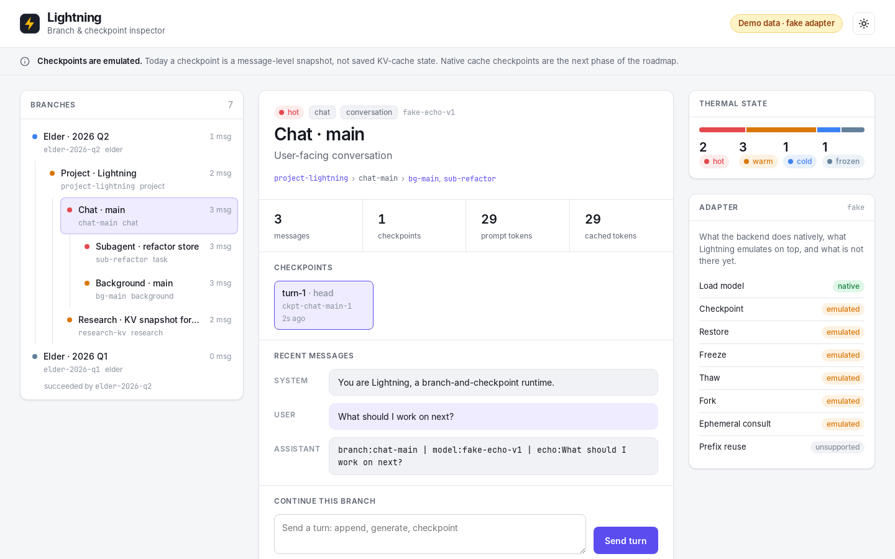
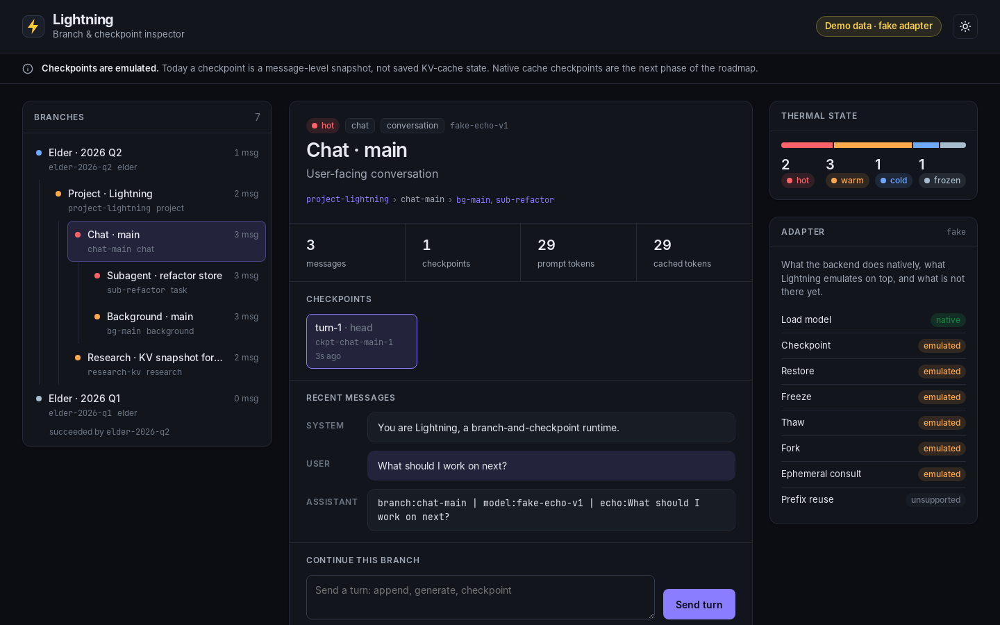
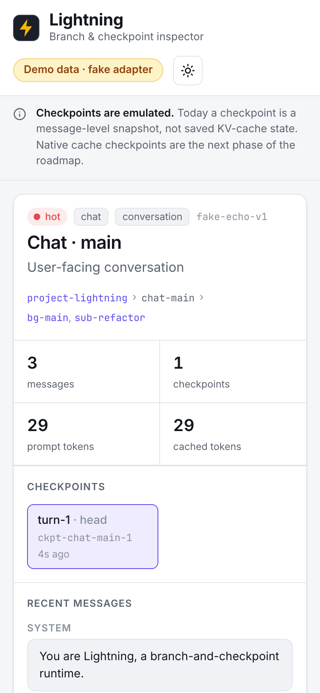
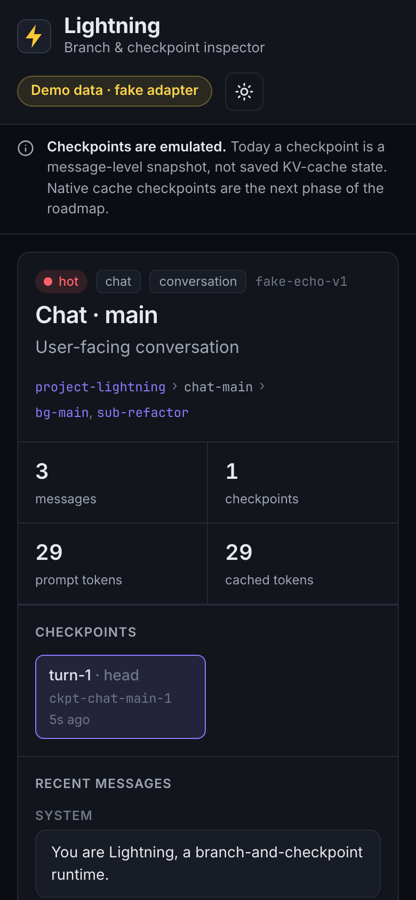

# Lightning

> KVCache rules everything around me.

Lightning is a sketch of a different shape for LLM runtimes: stop treating context as a transcript you replay, and start treating it as a checkpoint you continue from.

It is an idea with a runnable first slice, not a finished runtime. The branch model, the HTTP API and a working `llama.cpp` backend exist. The part that would make it fast, real KV-cache checkpoints, does not exist yet.


## The idea

Almost every chat system today runs this loop:

```
transcript + request → model → response
```

Every turn, you re-send the history (or a summary of it) and hope the server's prefix cache still matches. Memory systems, background "thinking" and summarization all fight over that same transcript, and every rewrite near the top invalidates the cache below it.

Lightning flips it:

```
request + checkpoint → model → response + next checkpoint
```

A visible conversation is just one way to serialize the state. The runnable object is the checkpoint.

Once you think that way, the rest of the architecture falls out:

- **Branches, not one thread.** Continuity lives in a tree of mostly append-only branches. A chat lane, a background lane, a project, a research thread: each is its own branch with a parent, a responsibility and a lineage.
- **Stratify by write frequency.** Hot branches churn. Mid-frequency branches hold active project state. *Elder* branches are compressed and slow-changing. Keeping fast writes away from slow state is what keeps caches valid, and that is the real optimization target.
- **Thermal scheduling.** Branches are hot, warm, cold or frozen, so the runtime can focus on the relevant subtree and let the rest sleep.
- **Succession, not rewriting.** Compaction creates a *successor* branch instead of endlessly rewriting the old one. That preserves continuity, cache locality and an explicit inheritance chain. Summaries flow upward, leaf to parent to grandparent, so every write stays at the tail of some branch.
- **Subagents and superagents.** Subagents absorb local churn and return something compressed. Superagents absorb accumulated history and rewrite it into slower, more durable form.
- **"Lightning-capable" models.** Being able to answer prompts isn't enough. A model has to hold up under checkpointed, recursive, branch-aware continuation without looping or drifting. That should become something you evaluate, not something you assume.

The far end of the roadmap is *canonical replay*: given only a visible transcript, reconstruct a deterministic checkpoint that plausibly produced it, and use that as a stable continuity primitive.

The full design is in [`docs/ARCHITECTURE.md`](docs/ARCHITECTURE.md).

## What exists

A small, typed, tested TypeScript scaffold (about 3k lines, no runtime dependencies) that makes the shape concrete:

- an in-memory branch store with create, fork, freeze, thaw, checkpoint and restore;
- a thermal planner that ranks branches and assigns hot, warm and cold;
- a backend adapter contract where every capability (checkpoint, fork, prefix reuse, …) reports itself as `native`, `emulated` or `unsupported`;
- a fake adapter for demos and tests;
- a working `llama.cpp` adapter, plus a process manager that starts and supervises `llama-server` for you;
- an HTTP API on `127.0.0.1:8787`:
  - persistent threads: `POST /v1/threads/:id/messages`, `GET /v1/threads/:id`, `POST /v1/threads/:id/pin`;
  - checkpoint-native turns: `POST /v1/checkpoints/:id/respond`, `GET /v1/checkpoints/:id`;
  - an OpenAI-compatible `POST /v1/chat/completions`. Pass a `thread_id` and Lightning dedupes the prefix it already has, then appends only the new suffix;
  - `GET /v1/branches` and a branch inspector page at `/`.

What is honest to say about it today: checkpoints are in memory, and every adapter, `llama.cpp` included, emulates them at the message level. Native KV-cache checkpoints, persistence and successor compaction are the next phases. Streaming is not implemented.

## The inspector

The API server also serves a small inspector at `/`: the branch tree with its thermal state, each branch's lineage, checkpoints and recent messages, the adapter's capability report, and a box to send a turn to any branch.

| Light | Dark |
|---|---|
|  |  |

<p align="center">
  
  
</p>

The screenshots are from `npm run demo:ui`: the real runtime and API with the fake adapter and a seeded branch tree. The page says **Demo data** whenever the fake adapter is active. Branches, forks, checkpoints and thermal state are real runtime state; only generation is fake (it echoes your message).

## Try it

Requires Node.js (tested with 22) and npm.

```bash
git clone https://github.com/jon-vs-moloch/lightning.git
cd lightning
npm install
npm test           # builds, then runs the test suite
npm run demo       # in-memory runtime + fake adapter, printed to the terminal
npm run demo:ui    # the inspector with demo data at http://127.0.0.1:8787
```

`npm run demo` creates a chat branch, forks a background branch, generates, checkpoints and plans thermals:

```
⚡ Lightning in-memory runtime · fake adapter

Branches
  chat-main  ● hot  chat
  └─ bg-main  ● frozen  background

Generate chat-main
  reply       branch:chat-main | model:fake-echo-v1 | echo:Summarize what this runtime can do right now.
  tokens      21 prompt · 12 completion

Checkpoint
  id          ckpt-chat-main-1
  label       initial-chat-state
  summary     Initial in-memory conversation checkpoint
…
```

### With a real model

With a local GGUF model and `llama-server` (from [llama.cpp](https://github.com/ggml-org/llama.cpp)) on your `PATH`:

```bash
LIGHTNING_MODEL=/path/to/model.gguf npm run serve
```

Lightning starts `llama-server` on `127.0.0.1:8080`, waits for it to become healthy, and serves its own API and the inspector on `http://127.0.0.1:8787`. To attach to a `llama.cpp` server you already run, set `LLAMA_CPP_BASE_URL=http://127.0.0.1:8080` instead. Other settings: `LLAMA_CPP_BINARY`, `LLAMA_CPP_HOST`, `LLAMA_CPP_PORT`, `LLAMA_CPP_ARGS`, `LLAMA_CPP_MANAGED=0|1`, `HOST`, `PORT`.

```bash
curl -s http://127.0.0.1:8787/v1/threads/demo/messages \
  -H 'content-type: application/json' \
  -d '{"message": {"content": "What should I work on next?"}}'
```

That appends your message to the `demo` branch, generates through `llama.cpp`, appends the reply, checkpoints, and returns the new head checkpoint and branch stats.

## Where it came from

Lightning grew out of [Candle](https://github.com/jon-vs-moloch/candle), a browser experiment in giving a chat agent a continuous inner loop and actively managed context. Candle made the product shape visible. It also kept growing engine logic inside a browser tab, and the bottlenecks pointed at the runtime underneath. Lightning is the attempt to build that runtime, so Candle-like products can sit on top of it. Candle was never rebuilt on it.

## Layout

| Path | What it is |
|---|---|
| [`src/core/`](src/core) | Types, adapter contract, branch store, runtime and thermal planner |
| [`src/backends/`](src/backends) | Fake adapter, `llama.cpp` adapter and `llama-server` process manager |
| [`src/api/server.ts`](src/api/server.ts) | HTTP API and inspector route |
| [`public/index.html`](public/index.html) | The inspector (one static file) |
| [`src/examples/`](src/examples) | `npm run demo` and `npm run demo:ui` |
| [`docs/ARCHITECTURE.md`](docs/ARCHITECTURE.md) | The design |
| [`docs/ROADMAP.md`](docs/ROADMAP.md) | Phases, with current status |
| [`docs/HANDOFF.md`](docs/HANDOFF.md) | The original continuation note |

## Status

**Early scaffold and design essay.** The architecture is the point; the code is the first slice that makes it runnable. Phases 0 and 1 of the [roadmap](docs/ROADMAP.md) are done and Phase 2 is partly done. There is no streaming, no persistence and no native cache checkpointing yet.

## License

[Apache-2.0](LICENSE) © 2026 Jonathan Meriwether
